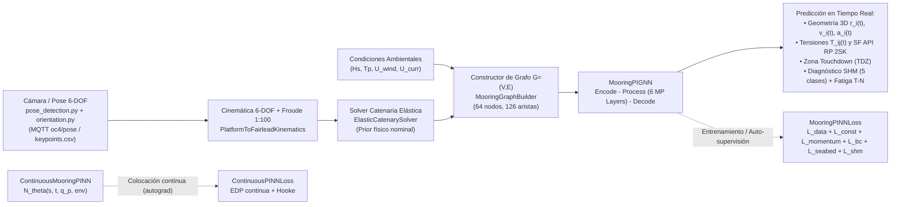

# Gemelo Digital de Líneas de Fondeo OC4 (Sistema Híbrido GNN + PINN)

Este módulo implementa la arquitectura neuronal híbrida **Physics-Informed Graph Neural Network (`MooringPIGNN`) + Continuous Coordinate PINN (`ContinuousMooringPINN`)** para predecir en tiempo real el estado estructural 3D, las tensiones axiales, la zona de contacto con el lecho marino (*Touchdown Zone*, TDZ), la fatiga acumulada y el diagnóstico de salud estructural (*Structural Health Monitoring*, SHM) de las **3 líneas de fondeo** de la plataforma semisumergible **OC4-DeepCwind** (NREL/TP-5000-60601).

---

## 1. Arquitectura General en el Pipeline OC4



---

## 2. Representación Física y Topológica del Grafo $\mathcal{G} = (\mathcal{V}, \mathcal{E})$

El sistema de fondeo OC4 consta de $K = 3$ líneas simétricas ($\alpha_k \in \{180^\circ, 60^\circ, 300^\circ\}$) conectando los 3 *fairleads* ($R_{\text{fair}} = 40.868\text{ m}, z = -14.0\text{ m}$) con los anclajes en el fondo marino ($R_{\text{anch}} = 837.6\text{ m}, z = -200.0\text{ m}$), con longitud sin estirar $L_0 = 835.5\text{ m}$.

- **Nodos ($\mathcal{V}$, $64$ en total con $N=20$ segmentos por línea)**:
  - **Nodos de línea ($3 \times 21 = 63$)**: codifican $[\mathbf{r}_i^{\text{cat}}/L_0, \mathbf{r}_i^{(0)}/L_0, \mathbf{v}_i^{\text{prior}}/v_{\text{ref}}, s_i/L_0, \text{BC}_{\text{anch}}, \text{BC}_{\text{fair}}, EA/EA_0, w/w_0, h_{\text{clearance}}]$.
  - **Super-nodo plataforma ($v_p$, $1$)**: codifica la pose 6-DOF global y velocidad de la plataforma, acoplado al vector de contexto ambiental $\mathbf{g} = [\mathbf{q}_p, \dot{\mathbf{q}}_p, H_s, T_p, U_{\text{wind}}, U_{\text{curr}}]$.
- **Aristas ($\mathcal{E}$, $126$ dirigidas)**:
  - **Intra-línea bidireccionales ($120$)**: propagan deformación axial $\epsilon_{ij}$, vector relativo $\Delta\mathbf{r}_{ij}$, velocidad relativa y transmiten esfuerzos a lo largo de la catenaria.
  - **Acoplamiento plataforma–fairlead ($6$)**: permiten que la red detecte asimetrías de carga entre las 3 líneas (clave para diagnosticar pérdida de pretensión, biofouling o rotura de una línea).

---

## 3. Formulación Física de la PINN

### 3.1. Ley Constitutiva Axial (sin resistencia a compresión)
$$\hat{T}_{ij} = \text{ReLU}\left( EA_{\text{eff}} \cdot \text{ReLU}\left(\frac{\|\hat{\mathbf{r}}_j - \hat{\mathbf{r}}_i\| - l_0}{l_0}\right) + c_{\text{int}}\dot{\hat{\epsilon}}_{ij} \right)$$

### 3.2. Ecuación de Conservación del Momento Lineal 3D (EDP discretizada por masas concentradas)
Para cada nodo interior $j \in \{1, \dots, N-1\}$:
$$\mathbf{M}_{a, j}\hat{\mathbf{a}}_j - \left( \hat{T}_{j, j+1}\hat{\boldsymbol{\tau}}_{j, j+1} - \hat{T}_{j-1, j}\hat{\boldsymbol{\tau}}_{j-1, j} + \mathbf{f}_{g, j} + \mathbf{f}_{\text{Morison}, j} + \mathbf{f}_{\text{seabed}, j} \right) = \mathbf{0}$$
donde:
- $\mathbf{M}_{a, j}$ incluye la masa estructural $\mu l_0$ más la masa añadida normal/tangencial ($C_{an}=1.0, C_{at}=0.0$).
- $\mathbf{f}_{\text{Morison}, j}$ evalúa el arrastre cuadrático normal y tangencial ($C_{dn}=1.6, C_{dt}=0.1$).
- $\mathbf{f}_{\text{seabed}, j}$ modela el soporte normal del lecho marino en $z = -h$ más la penalización elástica de penetración y amortiguamiento vertical en la zona *Touchdown*.

### 3.3. Variante Continua (`ContinuousMooringPINN`)
Evalúa $\hat{\mathbf{r}}_k(s, t)$ y $\hat{T}_k(s, t)$ mediante codificación de Fourier y un *ansatz* analítico que impone de forma exacta las condiciones de contorno de ancla ($s=0$) y fairlead ($s=L_0$), calculando $\partial\mathbf{r}/\partial s$, $\partial^2\mathbf{r}/\partial s^2$, $\partial\mathbf{r}/\partial t$ y $\partial^2\mathbf{r}/\partial t^2$ con `torch.autograd.grad`.

---

## 4. Diagnóstico SHM y Fatiga

El cabezal multi-tarea por línea clasifica 5 estados operativos y estima los factores de salud efectivos $(\hat{\delta}_{EA, k}, \hat{\delta}_{w, k})$:
1. `HEALTHY`: comportamiento nominal OC4.
2. `PRETENSION_LOSS`: pérdida de pretensión / deslizamiento de ancla.
3. `STIFFNESS_DEGRADATION`: degradación de rigidez axial $EA$ (corrosión / rotura parcial de torones).
4. `BIOFOULING`: incremento de peso sumergido y arrastre por colonización marina.
5. `LINE_BREAKAGE`: rotura completa de línea (tensión $\to 0$ y redistribución en líneas sanas).

Además, `MooringRealtimePredictor` calcula el factor de seguridad normativo **API RP 2SK** ($\text{SF}_k = \text{MBL} / T_{\text{fair}, k}$) y el daño incremental por fatiga mediante curvas **T-N (DNV-OS-E301)**.

---

## 5. Uso Rápido

### Verificación rápida de entrenamiento + autograd PDE
```bash
.venv/bin/python utils/scripts/postprocess/Mooring_GNN_PINN/train_mooring_pinn.py --epochs 5 --samples 32 --verify-only
```

### Entrenamiento completo (datos sintéticos + regularización física con trayectorias reales)
```bash
.venv/bin/python utils/scripts/postprocess/Mooring_GNN_PINN/train_mooring_pinn.py \
  --epochs 40 --samples 512 \
  --recordings-glob "results/recordings/*/keypoints.csv"
```

### Inferencia en tiempo real sobre grabaciones 6-DOF
```bash
.venv/bin/python utils/scripts/postprocess/Mooring_GNN_PINN/realtime_predictor.py \
  --csv results/recordings/20261110_121050/keypoints.csv --max-frames 5
```
